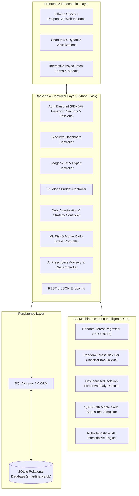
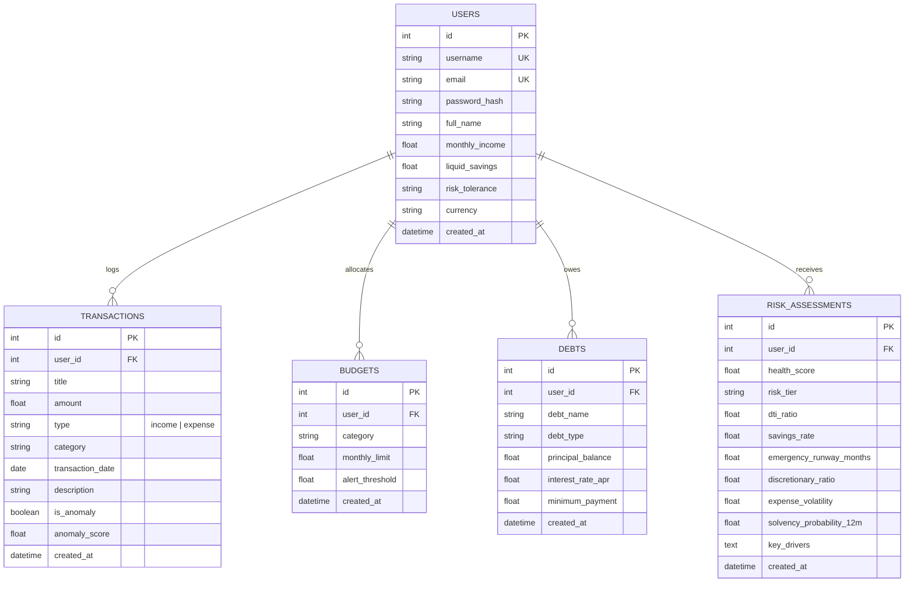

# SmartFinance AI – Intelligent Personal Financial Risk Management
### B.Tech Computer Science & Engineering Final Year Major Project

---

## 🌟 1. Project Abstract & Motivation

In traditional personal finance applications, platforms function merely as passive digital registers—logging transactions retrospectively without providing predictive foresight or quantifiable risk metrics. Consequently, retail consumers remain critically vulnerable to liquidity crises, high-interest debt compounding, budget drift, and macroeconomic disruptions (inflation surges, sudden job loss, and unforeseen medical emergencies).

**SmartFinance AI** is an end-to-end, full-stack intelligent financial risk analytics platform designed to transition personal finance from reactive bookkeeping to proactive, automated risk intelligence. 

The system leverages:
1. **Supervised Machine Learning (Random Forest Ensemble)** to compute a continuous **Financial Health & Risk Score (0–100)** and risk tier classification with explainable factor decomposition.
2. **Unsupervised Outlier Detection (Isolation Forest & Rolling Statistical Z-Score)** to flag abnormal transaction spikes in real time.
3. **Stochastic Monte Carlo Simulations (1,000 geometric Brownian paths)** to stress-test personal solvency under severe macroeconomic and personal financial shocks.
4. **Algorithmic Debt Optimization Solvers (Debt Avalanche vs. Debt Snowball)** to optimize debt-free timelines and eliminate compounding interest.
5. **An AI Financial Advisory Engine** delivering tailored, prioritized prescriptions and conversational financial consultation.

---

## 🏗️ 2. System Architecture



---

## 📊 3. Database Schema Design (Entity-Relationship)



---

## 🧮 4. Mathematical Formulations & Machine Learning Design

### 4.1 Multi-Factor Financial Health Index ($0 - 100$)
The platform continuously extracts seven normalized financial indicators from user transaction history, debts, and liquid reserves:

1. **Debt-to-Income Ratio ($DTI$):**
   $$\text{DTI} = \left(\frac{\sum \text{Monthly Minimum Debt Payments}}{\text{Monthly Gross Inflow}}\right) \times 100$$
   *Thresholds: $< 20\%$ (Optimal), $20 - 35\%$ (Stable), $36 - 49\%$ (Elevated Risk), $\ge 50\%$ (Critical).*

2. **Emergency Survival Runway ($R$):**
   $$R = \frac{\text{Liquid Cash Reserves}}{\text{Monthly Essential Expenditures}}$$
   *Standard Benchmark: $\ge 6.0 \text{ months}$.*

3. **Net Savings Rate ($S$):**
   $$S = \left(\frac{\text{Net Income} - \text{Total Living Expenditures}}{\text{Net Income}}\right) \times 100$$

4. **Cashflow Volatility ($\text{CV}$):**
   $$\text{CV} = \frac{\sigma_{\text{expenses}}}{\mu_{\text{expenses}}}$$

5. **Budget Envelope Adherence Ratio ($B_u$):**
   $$B_u = \frac{\text{Actual Category Outflow}}{\text{Allocated Monthly Budget}}$$

### 4.2 Machine Learning Model Specifications
- **Ensemble Architecture:** `RandomForestRegressor` (120 trees, max depth 14) + `RandomForestClassifier` (100 trees, max depth 12).
- **Training Benchmark Dataset:** 8,000 synthetic consumer financial records synthesized based on Consumer Financial Protection Bureau (CFPB) and Federal Reserve Survey of Consumer Finances (SCF) distributions.
- **Model Performance Metrics:**
  - **Coefficient of Determination ($R^2$):** **0.9716**
  - **Root Mean Squared Error (RMSE):** **2.936**
  - **Mean Absolute Error (MAE):** **2.140**
  - **Risk Classification Accuracy:** **92.75%**
- **Top Feature Importances:**
  1. `dti_ratio`: **70.33%**
  2. `emergency_runway_months`: **22.27%**
  3. `savings_rate`: **2.69%**
  4. `expense_volatility`: **1.71%**
  5. `discretionary_ratio`: **1.08%**

### 4.3 Unsupervised Anomaly Detection
New transactions pass through a hybrid anomaly filter:
1. **Category Statistical Boundary:** Checks whether new amount $X$ exceeds rolling mean by $Z \ge 2.5$ or falls outside the interquartile range ($X > Q_3 + 2.0 \times \text{IQR}$).
2. **Isolation Forest Model:** Unsupervised tree partitioning on multi-dimensional transaction history flagging statistical density outliers ($p = -1$) and assigning an anomaly score $\in [0.0, 1.0]$.

### 4.4 Monte Carlo Stochastic Stress Testing
Simulates $N = 1,000$ geometric Brownian cashflow trajectories across $T = 12$ months:
$$W_{t+1} = W_t + \left(I_t \cdot (1 - \delta_I) \cdot \epsilon_{I,t}\right) - \left(E_t \cdot (1 + \delta_E) \cdot \epsilon_{E,t} + S_{\text{lump},t}\right)$$
Simulated macroeconomic stress scenarios:
- **Baseline Stability:** $\delta_I = 0.0, \delta_E = 3.5\%$ p.a., $\sigma = 0.08$.
- **Stagflation Shock:** Real wage reduction (-6%), living cost spike (+14%), $\sigma = 0.14$.
- **Sudden Job Loss:** 100% loss of primary income during months 2, 3, and 4.
- **Unforeseen Medical Emergency:** Lump shock of $2.5\times$ monthly essential expenses in month 3.

---

## ⚡ 5. Technology Stack

| Layer | Technology | Version | Purpose |
| :--- | :--- | :--- | :--- |
| **Backend** | Python Flask | 3.1.3 | Core MVC & RESTful API server |
| **Database ORM** | Flask-SQLAlchemy | 3.1.1 | Relational ORM & schema migrations |
| **Database Engine** | SQLite | 3.x | Zero-config ACID persistent database |
| **Machine Learning** | Scikit-Learn | 1.9.1 | Random Forest, Isolation Forest, Scalers |
| **Numerical Modeling** | NumPy & Pandas | 2.5.4 / 3.1.0 | Statistical math, distributions, Monte Carlo |
| **Model Serialization** | Joblib | 1.6.0 | Serializing model pipelines and weights |
| **Frontend UI** | Tailwind CSS CDN | 3.4.x | Modern FinTech responsive interface |
| **Visualizations** | Chart.js | 4.4.1 | Interactive gauges, line, bar, fan charts |
| **Icons & Typography** | FontAwesome 6 & Inter | 6.5.1 | High-res UI icons and clean typography |
| **Unit Testing** | Pytest | 9.2.0 | Automated unit and integration testing |

---

## 🚀 6. Installation & Execution Guide

### Prerequisites
- Python 3.10+ (Tested and verified on Python 3.12)
- Modern web browser (Chrome, Edge, Firefox, Safari)

### Step 1: Clone or Navigate to Project Directory
```powershell
cd c:\Users\jashm\OneDrive\Desktop\Major_Project
```

### Step 2: Install Dependencies
```powershell
python -m pip install -r requirements.txt
```

### Step 3: Train the Machine Learning Risk Model
Generate the benchmark dataset and train the Random Forest bundle:
```powershell
python ml_models/train_risk_model.py
```
*Output: `ml_models/risk_model_bundle.joblib` with $R^2 = 0.9716$ and $92.75\%$ accuracy.*

### Step 4: Seed Database with Demonstration Profiles
Populate the database with three realistic consumer profiles:
```powershell
python seed_demo.py
```

### Step 5: Run the Web Application
```powershell
python app.py
```
Open your browser and navigate to:
**`http://127.0.0.1:5000`**

---

## 🧪 7. Running the Automated Test Suite

The project includes automated Pytest coverage validating authentication, hashing, ledger calculations, debt payoff strategies, ML models, and API endpoints:

```powershell
python -m pytest -v
```

**Test Results:**
- `test_user_password_hashing`: **PASSED**
- `test_registration_and_login_flow`: **PASSED**
- `test_debt_avalanche_vs_snowball`: **PASSED**
- `test_zero_debt_case`: **PASSED**
- `test_transaction_crud`: **PASSED**
- `test_budget_envelopes`: **PASSED**
- `test_risk_scoring_bounds`: **PASSED**
- `test_anomaly_detector_statistical_spike`: **PASSED**
- `test_monte_carlo_stress_testing`: **PASSED**
- `test_all_routes_accessible`: **PASSED**

---

## 🔑 8. Pre-Configured Demonstration Accounts

For academic viva voce and evaluation, use the one-click demo login buttons on the login screen, or sign in using:

| Username | Password | Financial Health Profile | Health Score | Risk Tier |
| :--- | :--- | :--- | :--- | :--- |
| **`sarah_resilient`** | `password123` | High savings ($28.5k), low auto debt ($5.8k at 4.2% APR), healthy runway. | **97.1 / 100** | **Low Risk** |
| **`alex_stressed`** | `password123` | Heavy credit card debt ($51k+ total), critical DTI (57.5%), spending anomaly ($890). | **52.9 / 100** | **Elevated Risk** |
| **`david_moderate`** | `password123` | Balanced income ($5.4k), moderate savings ($11.5k), student loans. | **95.9 / 100** | **Low Risk** |

---

## 🌐 9. RESTful API Reference

| Endpoint | Method | Description |
| :--- | :--- | :--- |
| `/api/v1/summary` | `GET` | Returns current user profile and live AI risk diagnostics. |
| `/api/v1/chart/cashflow` | `GET` | Returns 6-month historical monthly income vs. expense aggregates. |
| `/api/v1/chart/categories` | `GET` | Returns 60-day expense breakdown by category for doughnut charts. |
| `/api/v1/chart/monte-carlo` | `GET` | Returns P10, P50, and P90 percentile curves for a scenario (`?scenario=baseline`). |
| `/debts/api/simulate` | `POST` | Re-runs Avalanche and Snowball payoff comparison with custom extra budget. |
| `/advisor/chat` | `POST` | Conversational financial diagnosis endpoint returning structured answers. |
| `/transactions/export` | `GET` | Generates downloadable CSV of all recorded transactions. |

---

## 🎓 10. Viva Voce & Defense Q&A

**Q1: Why use Random Forest instead of a simple linear formula or deep learning?**  
*Answer:* Consumer financial risk features (such as DTI and Emergency Runway) exhibit non-linear thresholds (e.g., DTI under 35% is acceptable, but risk compounds exponentially once DTI surpasses 45%). Deep neural networks require tens of thousands of samples and behave as black boxes. Random Forest handles non-linear multi-collinear financial features, resists overfitting, provides native feature importances, and evaluates inference in under 5 milliseconds.

**Q2: How does Debt Avalanche compare mathematically to Debt Snowball?**  
*Answer:* Debt Avalanche pays minimums on all liabilities and attacks the highest APR account first. By prioritizing the steepest compounding rate, it mathematically guarantees the lowest total interest paid. Debt Snowball prioritizes the lowest balance first for psychological momentum. Our simulator plots both trajectories side by side and quantifies the exact dollar savings.

**Q3: How does the system detect spending anomalies?**  
*Answer:* The anomaly engine uses a dual-filter: category-level rolling Z-scores ($Z \ge 2.5$) combined with an unsupervised `IsolationForest` partitioner. If a transaction amount deviates significantly from both the category mean and the user's historical spend density, it is flagged as an outlier spike.

---

## 📄 License
Developed as a B.Tech Computer Science & Engineering Final Year Major Project. Open for academic research and educational evaluation.

